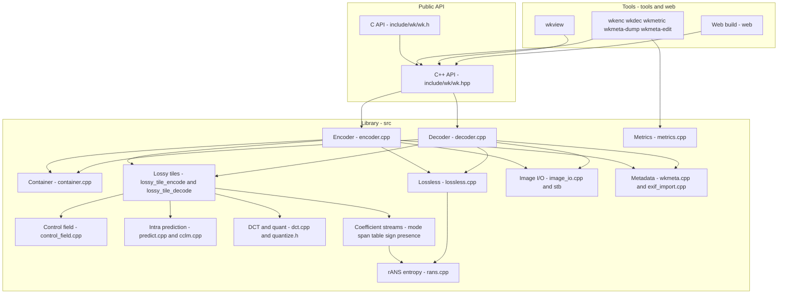
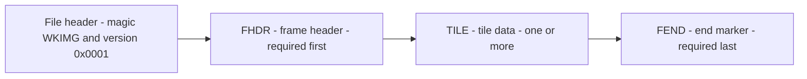
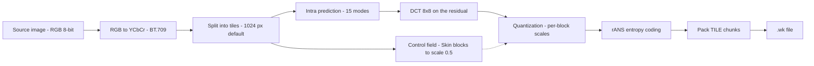
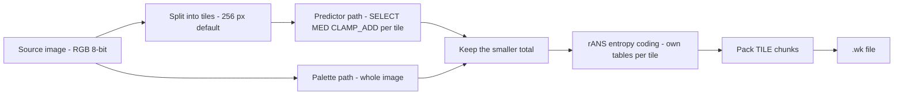

<p align="center">
  <picture>
    
  </picture>
</p>

<p align="center">
  <a href="SPEC.md"></a>
  <a href="LICENSE"></a>
  <a href="CMakeLists.txt"></a>
  <a href="CMakeLists.txt">= 3.28" /></a>
  <a href="#platform-notes"></a>
</p>


WK is an experimental still-image codec and container built around a native
`.wk` bitstream: tiled lossy and lossless coding, structured `WKMETA`
metadata, a small CLI toolchain, measurable image-quality analysis, and a
desktop compare viewer for visual inspection. Its differentiator is a
content-aware perceptual control field — the encoder classifies each block
(skin, sky, foliage, text, flat graphics) and can spend bits where the eye
actually notices them.

This is research software, not a finished product. It is developed and tested
Linux-first, it is honest about what it does not do yet, and it makes no claim
of beating JPEG, WebP, or AVIF on compression. The current stage is about
correctness, observability, and measured, incremental tuning.

- `JPEG/PNG/PPM -> WK`
- `WK -> PNG/PPM`
- metadata import, edit, and export through `WKMETA`
- numeric quality measurement through `wkmetric`
- side-by-side compare and format inspection through `wkview`
- an in-browser WebAssembly build under `web/`

## Quick Start

### Build (Linux)

```bash
cmake -S . -B build -DCMAKE_BUILD_TYPE=Release
cmake --build build --parallel
ctest --test-dir build --output-on-failure
```

Requirements: CMake `>= 3.28`, a C++23 compiler, Ninja (recommended), and
system zlib (`zlib1g-dev` on Ubuntu) for conditional `WKMETA` payload
compression.
Dependencies are fetched automatically by CMake: `minifb` for the viewer and
`googletest` for tests. The viewer is built by default (`WK_BUILD_VIEWER=ON`);
with `WK_BUILD_VIEWER=OFF`, `wkview` is still built but terminal-only.

### Encode and decode

```bash
# Lossless
./build/wkenc --lossless photos/people/ember-7f3a.jpg photos/people/ember-7f3a_lossless.wk

# Lossy, quality 75 (default)
./build/wkenc --quality 75 photos/people/ember-7f3a.jpg photos/people/ember-7f3a_lossy.wk

# Decode to PNG
./build/wkdec photos/people/ember-7f3a_lossy.wk photos/people/decoded_lossy.png

# Inspect a file
./build/wkdec --info photos/people/ember-7f3a_lossy.wk

# Measure a .wk against its source
./build/wkmetric photos/people/ember-7f3a.jpg photos/people/ember-7f3a_lossy.wk

# Compare visually in the viewer
./build/wkview photos/people/ember-7f3a_lossy.wk photos/people/ember-7f3a.jpg
```

## Architecture



The library is the codec; the tools are thin front-ends over the public API.
The encoder and decoder share the container parser, the tile machinery, the
rANS engine, and the coefficient streams — only the direction of the pipeline
differs.

## Format at a Glance

A `.wk` file is a little-endian container (format version `0x0001`) with a
fixed header, a sequence of 9-byte-framed chunks, and a strict parser: `FHDR`
must be first, `FEND` must exist and be last, tile payload sizes are
validated, unknown required chunks are rejected, and unknown optional chunks
are skipped safely.



Optional chunks (`META`, `ICCP`, `PROV`, `ANIM`) sit between `FHDR` and the
`TILE` chunks. The full bitstream specification is `SPEC.md` (v0.2.9).

| Chunk | Contents |
| --- | --- |
| `FHDR` | Frame header, 19 bytes: dimensions, bit depth, tile size, CICP |
| `META` | `WKMETA` structured metadata (optional) |
| `ICCP` | ICC color profile (optional) |
| `PROV` | C2PA manifest (optional) |
| `ANIM` | Animation header, present iff animated |
| `TILE` | One tile's payload, repeatable |
| `FEND` | End marker, zero-byte payload, required last |

Lossy tiles use one of eleven layouts, `V1`–`V11`, selected per tile by the
encoder; older files decode unchanged. The current layout, `V11`, adds
per-tile chroma subsampling on top of `V10` (CCLM chroma prediction), `V9`
(superblock quant map), `V8` (rANS-coded mode and span streams), and `V7`
(per-block quant scales plus the PLANAR prediction mode). Lossy coding uses
15 intra prediction modes (0–14, including PLANAR mode 13 and chroma-only
CCLM mode 14), 8×8 DCT, quantization-aware RDO mode selection, and 12-bit
rANS entropy coding.

## Pipelines

### Lossy encode



Each tile is converted to YCbCr (BT.709), split into 8×8 blocks, predicted
with the best of 15 intra modes under a quantization-aware RDO, transformed
with an 8×8 DCT, and quantized. Per-block quant scales ride the V7 scale
stream; mode, span, and coefficient streams are rANS-coded. Chroma is YUV444
by default, with per-tile YUV420 where the source chroma Laplacian says the
tile is smooth enough (V11, with edge and saturation safeguards that force
444 back). Lossy alpha, when present, is stored directly in the tile payload.

### Lossy decode

```mermaid
flowchart LR
    WK[".wk file"]
    PARSE["Parse container - FHDR first and FEND last"]
    TILE["Read TILE chunks"]
    RANS["rANS decode"]
    DQ["Dequantize - per-block scales"]
    IDCT["Inverse DCT 8x8"]
    REC["Add prediction to reconstruct"]
    CS["YCbCr to RGB - BT.709"]
    OUT["Decoded image - PNG or PPM"]

    WK --> PARSE --> TILE --> RANS --> DQ --> IDCT --> REC --> CS --> OUT
```



Decoding mirrors encoding: the container is parsed strictly, each tile's
streams are rANS-decoded, coefficients are dequantized (applying the tile's
per-block scales), inverse-transformed, and added to the prediction. The
decoder infers chroma subsampling from the tile header, not from a global
setting, and upsamples YUV420 tiles with the same filter the encoder assumes.

### Lossless



Lossless coding is per tile (256 px by default since v0.2.8). Each tile picks
its best predictor — `SELECT`, `MED` (JPEG-LS median edge detector), or
`CLAMP_ADD` — by true coded size, with its own rANS tables, so a tile's
payload is self-contained. The encoder compares that per-tile predictor total
against a whole-image palette path (including 18 bytes of container overhead
per tile) and keeps the smaller one, so a palette image can never regress.
The decoder stitches the tiles back into the frame; a single tile at (0,0)
is the pre-0.2.8 format and still decodes.

## Current Status

What is in a good working state right now:

- lossless still-image encode/decode, pixel-identical round-trips
- lossy still-image encode/decode, including lossy alpha in the tile payload
- per-tile adaptive chroma subsampling (V11) and CCLM chroma prediction (V10)
- the perceptual control field, opt-in via `--control-field` (see below)
- shared image metrics through `wkmetric` (file size, MAE, MSE, PSNR, SSIM,
  RGB per-channel and Y/Cb/Cr breakdowns, weighted chroma artifact metrics)
- strict container parsing with explicit failure on malformed files
  (20,000-iteration fuzzing, zero crashes)
- EXIF import into `WKMETA`, metadata edit and JSON export
- conditional zlib compression of `WKMETA` payloads, applied only when it
  shrinks the payload
- PNG output for 8-bit decode
- side-by-side compare viewer with file and format information
- C and C++ public APIs, and a WebAssembly build under `web/`
- 39 test binaries passing in the current tree (Release and ASan/UBSan)

What is intentionally not claimed as finished yet:

- full animation encode/decode, even though the spec and container already
  have animation structures
- native `.webp` output support
- advanced HDR output writers and full ICC-aware color-managed display
- compression efficiency that already competes with mature JPEG/WebP/AVIF
  encoders

## Perceptual Control Field

The control field (`src/core/control_field.cpp`) classifies every 8×8 block by
content — luma classes (Flat, Edge, Textured, Normal) plus, from the tile's
chroma, content-type classes (Skin, Sky, Foliage, TextUI, FlatGraphics) —
and lets the encoder treat classes differently. It is off by default and
enabled with `--control-field` (or `EncoderConfig::use_control_field`).

The first policy built on it is **Skin protection**: blocks classified as
Skin get quant scale 0.5 (luma-only) through the V7 scale stream. Measured on
the built encoder over the 6-photo benchmark corpus at q75: file size
+2.46%, Skin-region PSNR +5.7 dB, face/arm-box PSNR +1.4 dB — an equal-SSIM
cost of +1.9% file for a visible gain on skin. Two honest caveats from the
same measurement: about 45% of the treated blocks are not human skin
(false positives such as warm rock and lake reflections), and the SSIM gain
on actual faces is below the visible threshold even though the PSNR gain is
large. See `docs/skin_protection_research_2026-11-16.md` for the full
measurement.

## CLI Tools

### `wkenc`

```text
wkenc [options] <input.{jpg,jpeg,png,ppm,webp}> [output.wk]
```

Main options: `--quality N` (0–100, default 75), `--lossless`,
`--tile-size N` (64–1024, power of two), `--threads N`, `--yuv444`
(default), `--yuv420`, `--control-field` / `--no-control-field`,
`--cclm` / `--no-cclm` (CCLM on by default),
`--adaptive-chroma-subsampling` (on by default) with
`--chroma-lap-threshold F` (default 2.1) and the p999 safeguards,
`--import-exif FILE`, `--import-icc FILE`, `--import-prov FILE`,
`--no-quality-score`, `--metrics` (decode the output and report PSNR/SSIM
vs the source), `--tile-stats`, `--coeff-stats`, `--version`.

Default tile policy: lossy still-image encode uses 1024 px tiles;
lossless uses 256 px tiles (since v0.2.8); `--tile-size N` overrides both.

### `wkdec`

```text
wkdec [options] <input.wk> [output.{png,ppm}]
```

Main options: `--info`, `--frame N`, `--export-meta FILE`, `--metrics FILE` (decode, then
report PSNR/SSIM vs a reference image). `--frame N` decodes frame N of an animated file
(the composited canvas of that frame); without it an animated file decodes as frame 0.
`.png` output is currently limited
to 8-bit decoded images; higher bit depths should use `.ppm` for now.

### `wkmetric`

```text
wkmetric [options] <reference.{wk,jpg,jpeg,png,ppm,webp}> <candidate.{wk,jpg,jpeg,png,ppm,webp}>
```

Main options: `--json`, `--rgb-only`. Accepts normal images or `.wk` files
on either side, decodes `.wk` internally, and prints file size, MAE, MSE,
PSNR, SSIM, RGB per-channel metrics, Y/Cb/Cr metrics, and weighted chroma
artifact metrics.

### `wkmeta-dump`

Prints `WKMETA` as JSON.

### `wkmeta-edit`

```text
wkmeta-edit [options] <input.wk>
```

Main options: `--set NS.TAG VALUE`, `--delete NS.TAG`, `--import-exif FILE`,
`--import-icc FILE`, `--import-prov FILE`, `--export-json`, `-o, --output FILE`.

### `wkview`

```text
wkview [options] <file.wk|directory> [source.{jpg,jpeg,png,ppm,webp}|source_directory]
```

With only a `.wk` file it shows the decoded image and `WK` format and file
details; with a second image path it shows a side-by-side compare (decoded
`WK` on the left, source on the right). Mode is auto by default: a window
when a display exists, otherwise the terminal. `--cli` forces the terminal
renderer (truecolor half-blocks, `--diff` heatmap, `--no-color` for a
grayscale ramp); `--window` forces a window. It suggests nearby filenames if
a `.wk` path is mistyped, and browses directories with a file list
(Left/Right or A/D to move between files).

## Demo

Below is a real `wkview` compare screenshot stored in this repo at
`extra/ember-7f3a_q85_demo.png`. It shows a decoded benchmark output against
the original JPEG source.


The viewer shows the decoded `WK` panel and the original source panel side
by side, with the filename on each side, file size for both sides, image
dimensions and bit depth, alpha status, `lossless` vs `lossy`, `WKMETA`,
`HDR`, tile size, frame count, and `CICP` information for the `.wk` side.

## Public API

### C++ API

Headers: `include/wk/wk.hpp`, `include/wk/wkmeta.hpp`.

Main entry points: `wk::encode(...)`, `wk::encode_with_stats(...)`,
`wk::decode(...)`, `wk::get_info(...)`, `wk::version()` (currently
`"0.2.8"`). `EncoderConfig` carries quality, lossless, subsampling, tile
size, `use_control_field`, `use_cclm`, and the adaptive-chroma thresholds.

### C API

Header: `include/wk/wk.h`.

Main entry points: `wk_encode(...)`, `wk_decode(...)`, `wk_get_info(...)`,
`wk_free(...)`, `wk_version(...)`, `wk_encoder_config_init(...)`.

## Tests

39 test binaries, run with `ctest --test-dir build --output-on-failure`:

- core: `rans_test`, `dct_test`, `predict_test`, `quantize_test`,
  `container_test`, `roundtrip_test`, `geo_roundtrip_test`
- coefficient streams: `mode_stream_test`, `mode_span_rans_test`,
  `coeff_span_stream_test`, `coeff_table_stream_test`,
  `coeff_table_bank_stream_test`, `coeff_sign_stream_test`,
  `coeff_presence_stream_test`, `lossy_coeff_stream_test`
- features: `cclm_test`, `adaptive_chroma_test`, `control_field_test`,
  `skin_protection_test`, `superblock_quant_test`, `tile_util_test`,
  `threading_test`
- metadata and I/O: `wkmeta_test`, `wkmeta_strict_test`, `exif_gps_test`,
  `image_io_test`, `metrics_test`, `tool_log_test`
- API: `c_api_test`, `wk_hpp_test`

The validated path includes lossless and lossy round-trips, lossy alpha
round-trips, malformed entropy-stream and container rejection, metadata
round-trips, metric correctness checks, and JPEG integration on the bundled
sample photos.

## Benchmark

The reproducible benchmark is `benchmark/rd_bench.py` (image set: the six
photos under `photos/people/` and `photos/scenery/`):

```bash
python3 benchmark/rd_bench.py --bin-dir build-linux --qualities 10,25,50,75,85,90,95,100 --out benchmark/results/rd_baseline
```

The current snapshot below was measured with the encoder in this tree at
q75, default settings, against the six-photo corpus
(`benchmark/results/rd_baseline.md` holds the full q-curve).

| Photo | Dimensions | `.wk` bytes (q75) | PSNR (dB) | SSIM |
| --- | ---: | ---: | ---: | ---: |
| ember-7f3a | 225×225 | 18,432 | 40.166 | 0.9906 |
| mira-5b8d | 217×233 | 9,207 | 44.823 | 0.9915 |
| solis-2c9e | 663×372 | 31,853 | 41.413 | 0.9777 |
| horizon-4e2a | 1200×673 | 262,088 | 36.922 | 0.9255 |
| meadow-6d3b | 935×360 | 157,875 | 40.450 | 0.9849 |
| noctis-8c1f | 3000×1951 | 577,320 | 41.966 | 0.9769 |
| **Total / average** | | **1,056,775** | **40.96** | **0.9745** |

RD curve (average over the same six photos, from
`benchmark/results/rd_baseline.md`):

| Quality | Avg PSNR (dB) | Avg SSIM | Avg bpp | Total bytes |
| ---: | ---: | ---: | ---: | ---: |
| 10 | 28.29 | 0.8090 | 0.4090 | 170,938 |
| 25 | 31.09 | 0.8834 | 0.7943 | 328,939 |
| 50 | 34.77 | 0.9354 | 1.2303 | 553,274 |
| 75 | 40.96 | 0.9745 | 2.0900 | 1,056,775 |
| 85 | 44.34 | 0.9870 | 3.3325 | 1,809,660 |
| 90 | 46.93 | 0.9929 | 4.7355 | 2,525,442 |
| 95 | 49.28 | 0.9967 | 6.0849 | 3,281,049 |
| 100 | 50.13 | 0.9974 | 6.9318 | 3,888,277 |

Corpus note: the files are a mixed-extension corpus, not pure JPEG —
`solis-2c9e.jpg` is actually a WebP file and `horizon-4e2a.jpg` is actually a
PNG. A PowerShell corpus runner also exists at
`utils/benchmark_corpus.ps1`, and a smoke script at `utils/test_codec.sh`.

## Web

`web/` is a WebAssembly build ("WK Web Codec Studio"): the encoder and
decoder run entirely in the browser with no server-side processing. It
decodes `.wk` files to an HTML canvas, encodes PNG/JPEG images into `.wk`,
and shows file metadata and a luma histogram. Build it with Emscripten (see
`web/README.md`); a local HTTP server is required because WASM files need
proper MIME types.

## Platform Notes

Linux is the primary platform: the full workflow — including JPEG, PNG, BMP,
TGA, and GIF input via `stb_image`/`stb_image_write` v2.32, and the `wkview`
window — is developed and tested on Linux. Image dimensions are capped at
65,535 per side and 2^28 pixels total.

Windows still builds (CMake + a C++23 compiler; MinGW was used historically),
but it is not the validation target: the Linux+Windows same-SHA merge gate is
suspended, and Windows-specific issues are not chased while the format is
still stabilizing. The old WIC image-I/O layer has been removed; image I/O is
the same `stb`-based code on all platforms.

## Repository Layout

```text
include/    public headers (wk.hpp, wk.h, wkmeta.hpp)
src/        core/ (portable codec), arch/ (per-target code), stb/ (vendored image I/O)
tools/      CLI tools and viewer (wkenc, wkdec, wkmetric, wkmeta-dump, wkmeta-edit, wkview)
tests/      unit and integration tests (39 test binaries)
photos/     sample corpus split into people/ and scenery/
benchmark/  RD harness (rd_bench.py), baselines, and generated outputs
extra/      screenshots, demo assets, and the WK logo
utils/      helper scripts for benchmarking and smoke runs
web/        WebAssembly build (WK Web Codec Studio)
ideas/      roadmap and design notes
```

## Known Limitations

- native `.webp` output is not implemented (input is supported)
- animation structures exist in the format, but the animation workflow is
  not complete yet
- PNG writing is 8-bit only
- viewer HDR preview is a deterministic 8-bit preview, not full color-managed
  HDR display
- the control field's content-type classes are heuristic (color and texture
  rules, not a learned model): pale skin is detected weakly and warm rock,
  cream fabric, and lake reflections can be classified as skin
- compression still needs substantial tuning to become truly competitive on
  file size

## Roadmap

The direction is the phased plan in `ideas/NEXT_GEN_CODEC_ROADMAP.md`:

1. Syntax efficiency (done — V1–V11 layouts, rANS streams)
2. Content-aware perceptual control field (in progress — classifier live,
   Skin protection built; multi-scale waits until the field is proven)
3. Adaptive quantization and local modeling (partial — per-block V7 scales,
   adaptive chroma)
4. Multi-scale representation
5. Variable transform and partition system
6. Perceptual post-processing
7. Non-photo tools
8. Modern imaging (HDR/WCG, alpha, metadata)
9. Animation and layering
10. ROI and parallelism
11. Lossless architecture
12. SIMD optimization, last — it improves speed, not compression ratio

The goal is a next-generation codec: strong lossy and lossless, SDR/HDR/WCG,
alpha, modern metadata, mixed content, and progressive streaming — with the
perceptual control field as its differentiator.

## Reference Docs

- `SPEC.md` — bitstream and container format (v0.2.8)
- `META_GUIDE.md` — metadata usage
- `BENCHMARK.md` — benchmark and testing notes
- `web/README.md` — WebAssembly build
- `ideas/NEXT_GEN_CODEC_ROADMAP.md` — phased roadmap
- `ideas/PERCEPTUAL_CONTROL_FIELD.md` — control-field design
- `docs/skin_protection_research_2026-11-16.md` — Skin protection measurement
